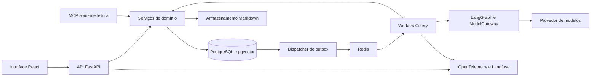

# Arquitetura e limites de escala

## Estrutura inicial

Monorepo com backend modular e workers. Uma aplicação de domínio compartilhada atende REST, jobs e MCP. Separar processos não exige separar repositórios nem criar microserviços.

```text
apps/web/                 React, biblioteca, editor e revisão
apps/api/                 FastAPI, autenticação e contratos HTTP
packages/core/            workspaces, documentos, propostas e aplicação
packages/ai/              retrieval, prompts, ModelGateway e LangGraph
packages/workers/         tarefas Celery, outbox e reconciliação
packages/mcp/             ferramentas somente leitura sobre o domínio
evals/                    corpora, casos, configurações e relatórios
infra/compose/            desenvolvimento e self-hosting
infra/terraform/          ambiente AWS de referência
docs/adr/                 decisões e alternativas
tests/                    integração, segurança, recuperação e e2e
```

O layout é uma proposta inicial; adaptar convenções de pacote sem alterar os limites de domínio. Configuração de dependências deve permitir que API, worker e MCP usem o mesmo código.



## Responsabilidades

- `DocumentService`: leitura, revisões, edição, paths, arquivo ativo e indexação pendente.
- `RetrievalService`: autorização, filtros, busca, fusão de rankings e evidências versionadas.
- `ProposalService`: ciclo da proposta, validações, revisão humana e exportação.
- `ApplyService`: aprovação, controle de concorrência, journal, gravação e reconciliação.
- `JobService`: estado durável, leases, cancelamento, idempotência e eventos.
- `ModelGateway`: limites, capacidades, erros, chamadas e contabilização do provedor.

## Fontes de verdade

O Markdown ativo é a fonte canônica do conteúdo no armazenamento do workspace. PostgreSQL é a fonte de verdade de identidades, permissões, revisões, aprovação, jobs e auditoria. Full-text e embeddings são projeções reconstruíveis.

Manter snapshots imutáveis de conteúdo por hash e referências duráveis às revisões. Reconstruir a busca não deve apagar histórico ou aprovações. Um watcher reconcilia conteúdo com o banco; apagar o banco permite reimportar os textos, mas não recuperar metadados/auditoria sem backup.

## Armazenamento e implantação

`DocumentStore` deve fornecer leitura, snapshot, gravação versionada, listagem e exportação. Implementar filesystem na v1. A pasta é definida por configuração local/administrativa, nunca por um caminho arbitrário enviado por visitante remoto.

No modo local, a aplicação e o Obsidian podem ler a mesma pasta externa. Escrita pela aplicação exige workspace gerenciado. Uma cópia importada deve mostrar sua origem e não fingir sincronização bidirecional.

Na implantação inicial AWS, usar um host de aplicação com volume persistente e os mesmos contratos. Esse perfil não é altamente disponível nem escala horizontalmente os escritores de arquivos. Aumentar workers permite paralelismo em tarefas independentes, dentro dos limites do host e do provedor.

Um adaptador de armazenamento compartilhado com escrita condicional e coordenação distribuída é extensão necessária antes de múltiplos hosts escritores. Não implantar múltiplas APIs com discos locais divergentes.

## Consistência de jobs e eventos

Gravar alteração de domínio e evento de outbox na mesma transação PostgreSQL. Um dispatcher envia jobs ao Redis; reenvio é permitido e o consumidor deve ser idempotente. PostgreSQL mantém estados e leases; Redis não é a única cópia de resultados ou aprovações.

O watcher faz debounce, considera hash e versão do parser e evita gerar um novo evento lógico para cada observação do mesmo conteúdo. Eventos recebidos fora de ordem não tornam uma revisão antiga ativa. Remoções geram tombstone e invalidam resultados ativos de busca.

Manter escrita no filesystem fora de uma alegação de transação ACID com PostgreSQL. Usar o protocolo de journal e recuperação de [06](06-integridade-e-seguranca.md).

## Escalabilidade demonstrável

Testar corpora de 100, 1.000 e 10.000 documentos e concorrência de 1, 5 e 10 consultas. Publicar tamanho médio de documentos, número de chunks, hardware, versões, cache quente/frio, modelo, amostra e falhas. Essas cargas são cenários de benchmark, não capacidade prometida.

Demonstrar reindexação apenas do conteúdo alterado, batches de embeddings, limites de conexão, consultas paginadas, backpressure de filas e limite por workspace. Medir antes de adotar reranker, índices aproximados ou serviços adicionais.
